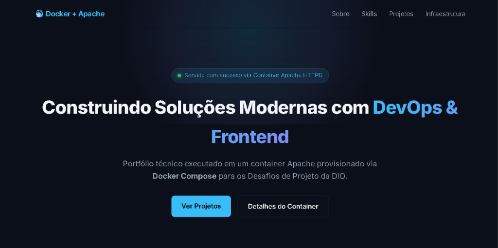
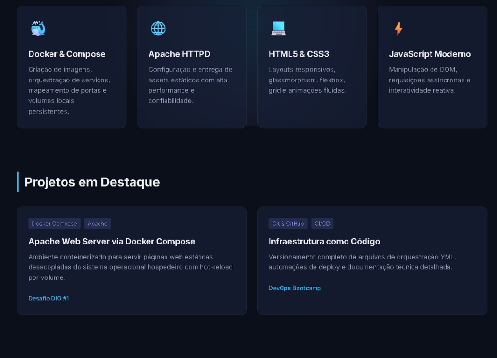
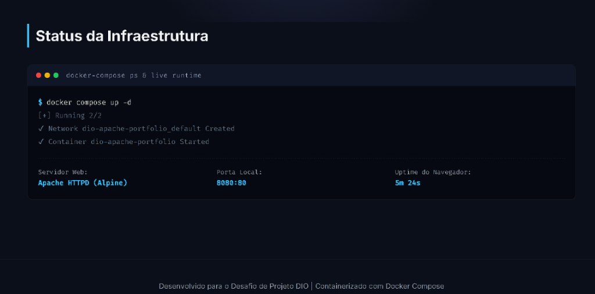

# Projeto Desafio DIO: Servidor Apache com Docker Compose 🐳

Este repositório contém a resolução do **Desafio de Projeto da DIO**, cujo objetivo é executar uma aplicação web conteinerizada em um servidor Apache HTTPD utilizando o **Docker Compose**, montando o código-fonte via volume dinâmico.

---

## 📸 Demonstração Visual

### 1. Hero Section & Status do Container


### 2. Habilidades & Projetos em Destaque


### 3. Status da Infraestrutura & Métricas de Runtime


---

## 🛠️ Tecnologias Utilizadas

- **Docker & Docker Compose**: Criação e orquestração do container.
- **Apache HTTPD (versão Alpine)**: Servidor web leve e de alta performance.
- **HTML5, CSS3 & JavaScript Vanilla**: Página de portfólio moderna com design escuro (glassmorphism), animações e contador de uptime.

---

## 📁 Estrutura de Arquivos

```text
docker-apache-portfolio/
│
├── docs/                  # Capturas de tela e assets de documentação
│   └── images/
├── docker-compose.yml     # Definição do serviço Apache e volumes
├── public/                # Diretório raiz servido pelo Apache (/usr/local/apache2/htdocs/)
│   ├── index.html         # Página principal do portfólio
│   ├── style.css          # Estilização moderna
│   └── app.js             # Lógica e interatividade JS
└── README.md              # Documentação e instruções de execução
```

---

## 🚀 Como Executar o Projeto

### Pré-requisitos
- [Docker Desktop](https://www.docker.com/products/docker-desktop/) instalado e em execução na máquina.
- Git instalado (opcional, para versionamento).

### Passo a Passo

1. **Abra o terminal** e navegue até a pasta do projeto:
   ```bash
   cd docker-apache-portfolio
   ```

2. **Inicie o container com o Docker Compose**:
   ```bash
   docker compose up -d
   ```
   *(Ou `docker-compose up -d` dependendo da versão do seu cliente Docker)*

3. **Acesse no seu navegador**:
   ```text
   http://localhost:8080
   ```

4. **Testando o Hot-Reload (Volume Montado)**:
   - Altere qualquer linha no arquivo `public/index.html` ou `public/style.css`.
   - Atualize a página no navegador (`F5`) para ver as mudanças refletidas instantaneamente, sem necessidade de reconstruir a imagem do container!

5. **Para parar o container**:
   ```bash
   docker compose down
   ```

---

## 🐙 Como Subir para o seu GitHub

1. Inicialize o repositório Git dentro da pasta do projeto:
   ```bash
   git init
   git add .
   git commit -m "feat: implementacao do desafio docker compose com apache e portfolio web"
   ```

2. Crie um novo repositório no seu perfil do GitHub (ex: `docker-compose-apache`).

3. Vincule a branch principal e faça o push:
   ```bash
   git branch -M main
   git remote add origin https://github.com/jAk7star/docker-compose-apache.git
   git push -u origin main
   ```

---

*Projeto realizado como parte do Bootcamp de Cloud & DevOps da [Digital Innovation One (DIO)](https://dio.me).*
